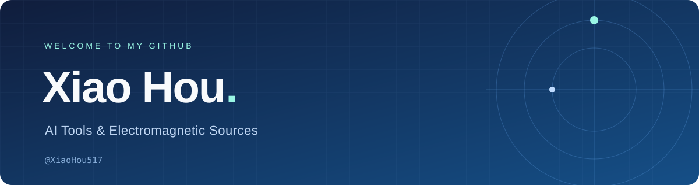

  

  <a href="https://github.com/XiaoHou517?tab=repositories">我的项目</a>
  &nbsp; · &nbsp;
  <a href="https://github.com/XiaoHou517?tab=stars">我的收藏</a>

## 你好，我是 Xiao Hou 👋

关注 **AI 工具**与**电磁辐射源**相关方向。

这里将记录我的工具探索、学习笔记与项目实践。

Exploring AI tools and electromagnetic sources, one project at a time.

---

### 关注方向

| 方向 | 计划记录的内容 |
| :--- | :--- |
| AI 工具 | 工具体验、使用心得与应用实践 |
| 电磁辐射源 | 相关知识、资料整理与学习笔记 |

### 项目与笔记

内容整理中，后续在这里更新项目与笔记链接。

<!-- 有公开作品后，可以将上面一句替换为项目链接和一句话介绍。
例如：
- [项目名称](项目链接) — 这个项目解决了什么问题。
-->

  Thanks for stopping by.

