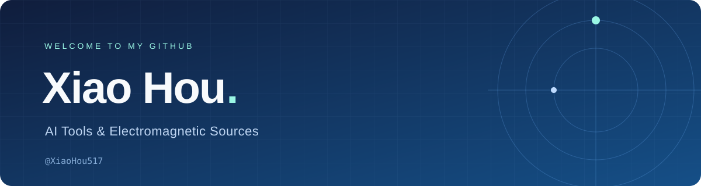

  

  <a href="https://github.com/XiaoHou517?tab=repositories">项目与笔记</a>
  &nbsp; · &nbsp;
  <a href="https://github.com/XiaoHou517?tab=stars">工具与资源收藏</a>

## 你好，我是 Xiao Hou 👋

我的专业是 **人工智能**，关注 **AI 工具的实际应用**，也对 **电磁辐射源**相关方向感兴趣。

希望把专业学习与动手实践结合起来，在这里记录学习笔记、工具体验与项目探索。

*My field of study is Artificial Intelligence. I’m interested in practical AI tools and electromagnetic sources.*

---

### 关注方向

| 方向 | 想要探索的内容 |
| :--- | :--- |
| 人工智能 | 专业知识的理解、学习笔记与实践 |
| AI 工具 | 工具体验，以及在学习、编程和资料整理中的应用 |
| 电磁辐射源 | 相关知识与资料，以及与人工智能结合的可能性 |

### 学习与实践

把学到的知识整理成笔记，把感兴趣的问题尝试做成小项目，让每一次探索留下可以回顾的记录。

[浏览我的公开仓库 →](https://github.com/XiaoHou517?tab=repositories)

  学习 · 实践 · 分享

